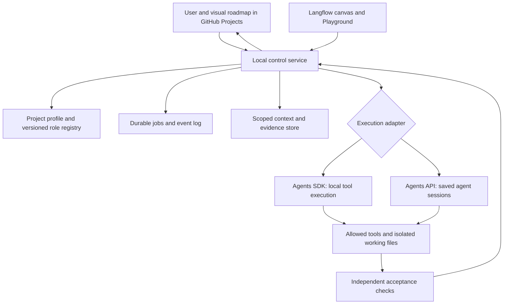

# Shared agent platform — architecture proposal

Status: partially implemented, 18 October 2026. The Langflow bridge, durable local jobs, saved-agent planning, file audit and proposal review pilot are implemented. The broader memory, agent publication and multi-project authorization design below remains a proposal. See [the installed bridge](LANGFLOW.md) and [the selected indie workflow](INDIE-WORKFLOW.md). Nothing in this document grants new tools or changes approval rules.

Use one small local control service, a visual workflow surface in Langflow, and GitHub Projects for human planning. Share the service across projects through explicit project profiles. Keep one execution owner for each job: an Agents SDK run or an Agents API session. Do not wrap the same task in three independent autonomous managers.

## Runtime and project responsibilities

| Shared core | Project profile |
| --- | --- |
| Jobs, retries, cancellation, locks and event log | Repository/workspace and allowed working directories |
| Typed tasks, handovers and artifact references | Role prompts, model settings and delegation graph |
| Tool access, secrets and budget enforcement | Approved tools and project-specific limits |
| Agent proposals, evaluation and version activation | Required evidence, test commands and acceptance checks |
| Context retrieval and memory curation | Domain vocabulary and evidence formats |
| Board synchronization and run links | Milestones, issue types and project priority |

Start with SQLite and immutable files referenced by hashes. A vector database is optional later; it does not supply correctness or access control. For one local worker, SQLite is adequate as an initial design choice, subject to concurrency tests. Avoid adding Redis, Kubernetes or a second orchestration framework before a bounded job needs them.

Nordic Forest requires source/derivative identity, ecological assumptions, matched visual comparisons and measured renderer costs. Beasts & Bumpkins requires binary/build identity, addresses/ABI, fixture evidence and explicit unsupported behavior boundaries. A VST project would add audio format, sample rate/block size, state persistence and controlled signal comparisons; a shader project would add reference buffers, color space, camera and GPU capture settings. Share the protocol and tooling patterns, not those projects' acceptance criteria or unverified facts.

## Agent changes and creation

AI can propose changed instructions and new roles. Publication is a separate operation performed by a policy-controlled registry service. This is our proposed governance, not a built-in guarantee of an LLM or Agents API.

1. A proposer supplies a patch or new role, base-version hash, concrete missing capability, affected tasks, evaluation examples, expected cost and requested tool profile.
2. Technical Lead checks need and fit. An independent QA reviewer checks regressions against fixed cases. A proposer cannot approve its own change. Include a domain specialist when the proposed behavior changes domain requirements.
3. Evaluate the candidate beside the active version on representative tasks; retain structured results and failure cases. A reviewer opinion alone is not a passing evaluation.
4. The registry activates an immutable version after the required approvals and checks. Pin each new job to a specific version; keep its predecessor for rollback. An in-flight run does not silently adopt new instructions.

| Change | Proposed decision authority |
| --- | --- |
| Prompt clarification within existing goals, tools and budget | Technical Lead plus independent QA and passing evaluations |
| New specialist using an already approved capability profile | Technical Lead plus independent QA, within a pre-authorized role/cost limit |
| Reprioritization inside a previously agreed milestone | Product Lead within its explicit mandate; show changes on the board |
| New credentials, broader tools/access, higher spend, changed project goal or relaxed acceptance requirements | User decision on a concrete proposed change |
| Missing artistic preference or unresolved product tradeoff | Ask the user when the answer changes the result; continue independent work |

Granting ordinary prompt text must never grant permission to edit the registry gate, increase its own budget, approve its own deployment or redefine acceptance. Keep secrets out of shared contexts. Routine bounded work should proceed without repeatedly asking the user.

OpenAI supports updating saved agent definitions, but existing sessions retain their copied configuration. Our registry must record the effective configuration for each run and deliberately create a new session when adopting changed instructions. [OpenAI configuration documentation](https://developers.openai.com/api/docs/guides/agents-api/configuration).

## Delegation and shared context

A task envelope should include `project_id`, `job_id`, `task_id`, parent task, responsible role/version, objective, allowed writes/tools, artifact references, acceptance checks, budget/deadline, assumptions and open questions. A specialist receives the smallest useful context plus cited evidence; it does not receive every past conversation.

Prefer a manager retaining responsibility and calling bounded specialists. Limit fan-out, depth, total calls and one critique/integration round at first. Use handoff only when responsibility for an interaction really changes. SDK orchestration supports manager and handoff patterns, but application code still owns the surrounding execution controls. [OpenAI orchestration guide](https://developers.openai.com/api/docs/guides/agents/orchestration).

Managed Agents API delegation is another execution option. Its automatically created subagents are not, by assumption, the 15 saved forest roles: verify their configuration and observation separately. Current documentation states that managed subagents inherit MCP/environment capabilities but do not support application function tools. That matters for the existing Python download function: use separate explicitly scheduled sessions or a suitable MCP adapter when taking the managed-delegation route. [OpenAI multi-agent guide](https://developers.openai.com/api/docs/guides/agents-api/multi-agent).

Use three memory layers:

- **Run/session context:** transient notes, messages and compacted history. Useful for continuity; not automatically verified knowledge.
- **Project knowledge:** claims linked to source hashes/revisions, observations versus inferences, date, confidence, status, superseding evidence and verification. A curator proposes promotions; deterministic checks and review decide what becomes accepted.
- **Shared procedures:** explicitly promoted generic recipes and harness interfaces. Project facts stay in their project namespace unless deliberately transferred with provenance.

Index exact artifact IDs and revisions in SQL; add semantic retrieval only when useful. Retrieval must enforce project access before returning text. Store assets as references rather than repeatedly sending meshes, entire repositories or credentials in prompts. Invalidate claims when their referenced source changes. [OpenAI session-memory example](https://developers.openai.com/cookbook/examples/agents_sdk/session_memory) addresses conversation memory, a different responsibility from the evidence store proposed here.

## Visual work management

**Earlier recommendation, superseded by the user’s GitHub Projects decision: Linear.** Its project milestones, timeline and issue structure suit this multi-project setup; its official MCP server supplies an initial integration path. Native agent sessions can later show agent progress and input requests in Linear, but that agent integration is currently documented as Developer Preview. [Milestones](https://linear.app/docs/project-milestones), [MCP](https://linear.app/docs/mcp), [agent integration](https://linear.app/developers/agents).

**Selected: GitHub Projects** if close linkage to repositories and pull requests matters more than a dedicated product-planning interface. It provides board, table and roadmap views with API automation. [GitHub Projects](https://docs.github.com/en/issues/planning-and-tracking-with-projects/learning-about-projects/about-projects).

For the current implementation, use Projects plus repository feature issues, story sub-issues, milestones and sprint/iteration fields. A possible later Linear mapping is initiative → project → milestone → issue → sub-issue. Use feature, research spike, bug, asset task and user story as appropriate issue classifications. A reverse-engineering investigation need not be disguised as a player-facing user story. Each ready issue needs scope, non-goals, inputs, deliverables, dependency links and independently checkable acceptance.

The board owns planned priority, scope, assignee and milestone. The control service owns run state, effective configuration and evidence. Synchronize through stable mappings and an outbox with idempotency keys, not bidirectional overwrites of every field. A completed model run does not mark a feature Done: actual acceptance evidence must pass first. Start with API calls/polling; Linear webhooks require a reachable HTTPS endpoint, so they are not an automatic property of a Mac-only service. [Linear webhooks](https://linear.app/developers/webhooks).

## Implementation order and acceptance

1. **Bridge proof:** Langflow → one offline preparation → one bounded saved-agent API session. Verify actual role/configuration identity, session ID, result, timeout and no duplicate start. Keep this separate from the current SDK baseline.
2. **Durable local jobs:** persist request and idempotency key before dispatch; save remote session IDs and reconcile after disconnect. Test restart and cancellation, including any outstanding tool operation. A Python timeout alone does not prove remote work stopped.
3. **Board adapter:** first preview a milestone/issue package; then write through a project-scoped connection with stable IDs. Test retry without duplicated tickets and evidence-gated Done.
4. **One actual feature:** a small asset audit/derivative task is a good Forest pilot. Provision tools and independent acceptance; compare its resulting files and measurements. Use an isolated worktree for implementation once Git is provisioned.
5. **Curated memory and role proposals:** add revision-aware retrieval and evaluated registry changes after the baseline tasks exist. Do not enable self-publication before a reliable comparison exists.
6. **Second project profile:** port the same protocol to a bounded Beasts & Bumpkins investigation. This is the practical test that the core is reusable.

The service is a thin control layer around existing runtimes, not a replacement for the SDK or OpenAI-managed harness. Langflow remains a useful visual authoring surface. Project credentials, source trees and capabilities do not become shared merely because two flows sit in the same application.
