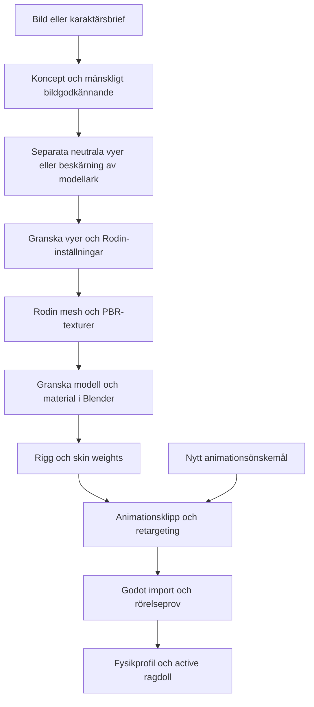

# Karaktärspipeline i Langflow

2026-10-22. **06 — Character Pipeline · Rodin** och **NF · Character Pipeline** finns i Langflow-projektet Nordic Forest. Flödet kan beskära ett modellark, förbereda och granska bild-/parameterpaketet, köra Rodin och bygga en lokal Blender-kroppsrigg från en explicit landmärkesprofil. Chattbaserad konceptgenerering, produktionsanimation, retargeting och active ragdoll är efterföljande integrationssteg.

## Produktionsflöde



Modellvyer visar samma figur i samma neutrala pose, med händer fria från kroppen. Varje fil innehåller en figur. Rörelsearket hålls separat: olika gång-, attack- och dödsposer ska inte styra samma geometrirekonstruktion. Efter meshgenereringen kan fler geometriskt konsekventa referensvyer renderas från den faktiska 3D-modellen.

[Rodins Gen-2.5-API](https://docs.hyper3d.ai/en/api-specification/rodin-gen2-5) tar upp till fem bilder och har T/A-pose-conditioning, PBR och texturinställningar. T/A-pose är en genereringsbegäran; kontrollera resultatets faktiska pose och anatomi. De granskade publika API-sidorna dokumenterar inte webbgränssnittets auto-riggning eller animationsbibliotek. De stegen behöver en verifierad API-adapter eller en manuell leverans från webbgränssnittet. De befintliga skripten för zombie-tjejens rigg innehåller karaktärsspecifika landmärken och kan inte användas oförändrade på andra kroppar.

## Kör ett steg

Starta bryggan med `python tools/manage_bridge.py start`. Öppna sedan Langflow-flödet och skicka ett kommando i Chat Input. **Execute stage** är avstängt från början. En förhandsgranskning av ett leverantörsanrop gör inga Rodin-anrop. `prepare` läser däremot de lokala bilderna och skapar ett granskningsunderlag.

| Kommando | Underlag | Resultat |
| --- | --- | --- |
| `split_sheet` | `sheet_path`, `panels` med `view` och pixelrektangel `[vänster, övre, höger, nedre]` | Förlustfria PNG-beskärningar med sparad källhash och layout |
| `prepare` | `character_id`, `brief`, `views`, valfria referensark och Rodin-inställningar | Oföränderligt granskningspaket och jobb-ID |
| `inspect` | `source_job_id` från `prepare` | Paket, granskningsbeslut och sparad leverantörsstatus |
| `balance` | Inget ytterligare | Aktuellt API-saldo |
| `run_rodin` | `source_job_id` från godkänt `prepare` | Kör submit, pollning och nedladdning automatiskt, högst 20 minuter lokalt |
| `submit_rodin` | `source_job_id` från godkänt `prepare` | Ett betalt mesh-/texturjobb |
| `poll_rodin` | Samma `source_job_id` | En statusavläsning med beständig väntetid mellan avläsningar |
| `fetch_rodin` | Samma `source_job_id`, alla leverantörsdeljobb `Done` | Lokala filer, hashvärden och kostnadskvitto |
| `rig_character` | `source_job_id`, `rig_profile` under `config/rig-profiles/` | Lokal kroppsrigg, skin weights, diagnostiskt klipp och validerade GLB-filer |

Godkänn ett färdigt `prepare`-paket i [den lokala kontrollpanelen](http://127.0.0.1:8765/). Godkännandet avser bildhasharna och inställningarna och tillåter en generering. `submit_rodin` är ett separat steg. För pilotkörningen registrerades användarens uttryckliga godkännande i chatten, inklusive tillåtelsen att beskära originalarket med skript; inget klick i kontrollpanelen påstås ha skett.

Färdiga exempel finns under `examples/characters/`. Beskärningen av strandturisten kan köras med:

```sh
python tools/character_stage.py examples/characters/beach-tourist-split.json --execute
python tools/character_stage.py examples/characters/beach-tourist-prepare.json
```

Använd **jobb-ID:t från din egen `prepare`-körning** i efterföljande kommandon. Pilotens `submit`, `poll`, `fetch` och `inspect` innehåller dess verkliga jobb-ID och är avsedda för avstämning av just den körningen. Nya karaktärer får egna kommandon, bildfiler och granskningsbeslut. Vybilder måste ligga i `assets/work/characters/` eller `assets/generated/characters/`.

## Beständighet och kostnader

Varje kommando sparas i den befintliga jobbdatabasen. Rodins privata prenumerationsidentifierare ligger i en fil med rättighet `0600` under `runs/control/artifacts/<prepare-jobb>/rodin-state.json` och lämnas inte till Langflow. API-nyckeln läses i backend från `.RODIN_API_KEY` eller miljövariabeln `RODIN_API_KEY`; filen är Git-ignorerad. Genererade filer ligger under `assets/generated/characters/<karaktär>/<prepare-jobb>/`.

En beständig markör skrivs före det betalda anropet. Om svaret försvinner skapar ett upprepat kommando inget nytt jobb: leverantörens historik måste stämmas av. Kända avslag sparar en begränsad felkod utan nycklar eller råa svarsmeddelanden. En ny Langflow submission key kringgår inte markören för samma paket.

Adaptern sparar `consumed` från genereringskvittot, saldot före anropet, saldot efter nedladdningen och användningsrader som matchar modellens task UUID. Saldoförändringen kan även innehålla annan kontoaktivitet; bara matchande användningsrader kan tillskrivas modellen. Uppdelningen per funktion ska följa leverantörens kvitto. [API-priserna](https://docs.hyper3d.ai/en/api-specification/rodin-gen2-5#pricing) och [kontots användningshistorik](https://docs.hyper3d.ai/en/api-specification/check-balance) är separata underlag.

Polling börjar tidigast efter fem sekunder och backar av till 30 sekunder. Med `run_rodin` fortsätter bryggans arbetare genom stegen i högst 20 minuter. Langflow-komponenten returnerar inom cirka 40 sekunder även om backend-jobbet fortsätter; följ det i kontrollpanelen. Ett lokalt avbrott stoppar väntandet och betyder inte att leverantörens jobb avbryts. Kör samma paket igen för att återansluta till dess sparade uppgift. `poll_rodin` ger också en separat statusavläsning utan ny generering. Alla deljobb måste vara färdiga före nedladdning, enligt [Rodins livscykel](https://docs.hyper3d.ai/en/get-started/quick-start).

## Animation och active ragdoll

Nya animationsklipp ska gå genom samma retargeting- och valideringssteg som originalklippen. Föreslaget leveranspaket innehåller karaktärs-ID, skeletthierarki och rest-pose-hash, enhet och koordinatsystem, klippets varaktighet och bildfrekvens, root-motion-policy, loopgräns, fotkontakter och eventmarkörer. Baka om till projektets gemensamma skelett, kontrollera deformation/fotkontakt och exportera en versionsmärkt AnimationLibrary eller GLB. Detta klippkontrakt är designunderlag; ingen automatisk animationsimportör är implementerad i första adaptern.

Spelet kan sedan välja lokalt validerade klipp som rörelsemål. En active-ragdoll-kontroller låter fysikkropparna försöka följa dessa mål med begränsade vridmoment, dämpning och ledgränser. Kroppsmassa i kilogram och tröghet hör till fysikprofilen; skin weights anger hur meshen deformeras och ersätter inte massorna. Samma klipp kan användas av olika kroppstyper efter retargeting, men kropparnas balans och styrparametrar behöver egna prov.

Första fysiska acceptansen bör omfatta vila, gång, lätt knuff, fall, övergång till slapp kropp och återhämtning om den ska stödjas. En liggande referensbild ger ingen fysiklösning för dödsfallet. [Godots ragdoll-stöd](https://docs.godotengine.org/en/stable/tutorials/physics/ragdoll_system.html) tillhandahåller fysiska ben och leder; en aktiv motorstyrd följare kräver ytterligare kontrollkod och stabilitetsprov. Börja med en enkel fysikfigur innan olika tunga karaktärer och skador ska styras av samma system.

## Verifiering

De automatiska testerna täcker oförändrade bildpixlar efter beskärning, fil-/symlinkgränser, separata rörelsereferenser, granskningshash, ogiltigförklaring vid ändrad bild, multipart-format, debiteringskvitto, återanvändning av betalt jobb, förlorat anropssvar, pollningsvillkor och spärrad förtida nedladdning. Langflow-komponenten har provkörts med dess installerade Python-runtime och verktygsschema; bara `request_json` exponeras i Tool Mode.

## Första strandturisten

Pilotens fyra vyer är pixelbevarande beskärningar av användarens ursprungliga modellark. Det separata rörelsearket följde inte med till Rodin. Gen-2.5 High med PBR, HighPack, T/A-pose-conditioning och mål på 30 000 quad-faces levererade en GLB på 44 960 556 byte. Blender-importen visar 55 984 trianglar och tre 4096×4096-texturer: albedo, normal och kombinerad metallic/roughness. Den exporterade meshen är triangulerad trots det begärda Quad-läget.

Modellen har en A-pose och behåller en del huvudlutning från underlaget. Den saknar skelett och animationsspår. Blender-vyerna och statisk Godot-import finns under `output/character-pipeline/beach-tourist-v1/`; riggning kräver ett nytt granskat steg.

| Del | Rodin-credits |
| --- | ---: |
| Lokal beskärning av fyra vyer | 0 |
| Rodin mesh och texturpaket | 0,5 |
| Nedladdning, Blender-granskning och Godot-import | Ingen ytterligare synlig debitering |
| Rigg och animation | Inte körda |
| Summa för genomförda steg | **0,5** |

Saldot gick från 216,5 till 216,0 credits. Genereringskvittots `consumed` och den matchande historikraden `api_generation_rodin_high` är båda 0,5. HighPack är inte separat prissatt i detta kvitto. Den första transportbegäran hade fel kodning av add-on-fältet; efter avstämning av oförändrat saldo och historik gjordes ett uttryckligt korrigerat försök. Första försöket har ingen observerad debitering.

Vid första Rodin-piloten passerade 84 automatiska tester. Den sammanhängande `run_rodin`-vägen har dessutom körts på det färdiga paketet och återanvände samma filer och modell-ID utan en ny generering. [Verifieringsunderlaget](character-pipeline-verification.json) innehåller parametrar, jobb-ID:n, kostnadskvitto, filhashar och importresultat.

## Lokal kroppsrigg

`rig_character` använder [strandturistens profil](../config/rig-profiles/beach-tourist-body-v1.json) med 22 Mixamo-namngivna kroppsben: höfter, rygg, nacke, huvud, axlar, armar, händer, ben, fötter och tåbas. Profilen är en uttrycklig initial anatomisk anpassning till den här modellens hash. En ny kroppsform behöver en egen granskad profil; detta är inte en generell automatisk ledigenkänning. Fingrarna följer respektive hand som en enhet i denna version.

```sh
python tools/character_stage.py examples/characters/beach-tourist-rig.json --execute
```

Blender körs isolerat med fabriksinställningar och utan automatiska startup-skript. Benheatsviktningen körs på en proxy där exakt sammanfallande UV-/normal-sömmar svetsas. Vikterna förs tillbaka till originalets identiska vertexpositioner; leveransmeshen behåller sina 31 497 vertices, UV-loopar och material. Vikterna normaliseras och begränsas till fyra per vertex. På den här figuren är största borttagna viktmassa före normalisering cirka 17,2 procent på en enskild proxyvertex; deformationen behöver därför bedömas i ledproverna, även om alla vertices har giltiga vikter.

Två GLB-filer levereras: `character-rigged.glb` med kroppsrigg och `character-rig-test.glb` med samma rigg och `QA_RigRange`. Det senare är ett sex sekunder långt diagnostiskt rörelseprov för armbågar, knän, axlar, hukning och huvudrotation. Det är inget gång- eller attackklipp och har ingen fot-IK eller balansstyrning. Blender-källan innehåller samma prov i tidslinjen.

GLB-filen återimporteras och jämförs vid 13 bildrutor med de deformerade Blender-verticesen. Största uppmätta avvikelsen är cirka 0,000011 Blender-enheter. Det verifierar att exporten bevarar den testade skinningen; slutlig ledanatomi och kvalitet i gameplay återstår att godkänna. Renderade ledprov finns i samma leveransmapp.

Bryggan binder jobbet till modell-, profil- och skripthash vid köläggning. Ändrade indata före exekvering avvisas. En färdig identisk leverans återanvänds efter filhashkontroll. Misslyckade körningar behålls för felsökning; en korrigerad profil eller skriptrevision får en ny leveransmapp och behöver en ny submission key. Det lokala steget gör inga Rodin-anrop och kostar **0 Rodin-credits**.

Godot 4.7.1 importerar kroppsrigen och `QA_RigRange`. GLB-tiderna behålls: första källbildrutan ligger vid 1/30 sekund, armbågens 90-gradersprov vid 31/30 och knäets 85-gradersprov vid 61/30 sekund. Standardoptimeringen tog bort nycklar vid provens toppar och gav cirka 2,7 graders avvikelse. För jämförelsen stängs `optimizer/enabled` och `compression/enabled` av på `_subresources.nodes["PATH:AnimationPlayer"]`. Då mäts 90,00001 respektive 84,99999 grader. Optimering för gameplay får utvärderas separat mot den här referensen. Verifieraren finns i `tools/verify_body_rig_godot.gd`. Hela Langflow-grafen har anropat riggsteget och återanvänt leveransen. Totalt 92 tester passerar. [Riggverifieringen](character-rigging-verification.json) innehåller värden, importinställningar och leveransfiler.

## Gemensam Godot-granskare

Mannens rigg har därefter fått kvinnans samtliga 13 klipp genom lokal bakad retargeting. Den befintliga Godot-scenen har modell- och animationsväljare för båda karaktärerna och en katalog för kommande modeller. Bytet behåller klipp, relativ tidpunkt, hastighet och pausstatus. Starta med `tools/open_character_review.command`; [kontroller, leveranser och verifiering](CHARACTER-REVIEW.md) beskriver resultatet. Detta steg kostar 0 ytterligare Rodin-credits; pilotens totalsumma är fortsatt 0,5.

Den 2026-10-23 tillkom ett lokalt fysiklabb i samma Godot-scen: aktiv posföljning, slapp ragdoll och dragbar boll med verkliga kollisioner på båda modellerna. Balanshjälpen är ett uttryckligt virtuellt höftstöd; fot-IK och självbärande balans återstår. Detta är ett granskningsläge i Godot, inte ett nytt exekveringssteg i Langflow. [Fysiklägets kontroller och begränsningar](CHARACTER-REVIEW.md#fysiklabb-med-dragbar-boll) och [provresultatet](active-ragdoll-verification.json) beskriver prototypen. Steget gör inga nya betalda anrop.
