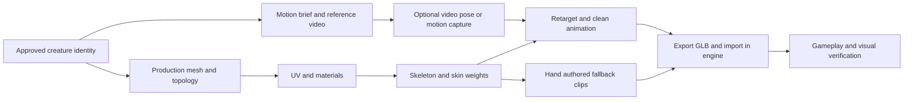

# Forest and creature production pipelines

The common foundation is versioned data, editable source assets and acceptance in the running engine. The pipeline definitions below are proposed contracts; adapters and artist tools remain to be implemented.

## Biome data and authoring

Use a hybrid workflow: procedural base fields for a useful starting point, paintable weight/exclusion masks, and explicit landmark overrides. Start with dry pine woodland, mesic spruce/mixed woodland and a damp spruce/birch hollow. These are three production presets along environmental gradients, not claims that all northern forests fit three categories.

[Skogskunskap's site descriptions](https://www.skogskunskap.se/skota-skog/foryngra/planera-och-forbered-foryngringen/standortsanpassad-foryngring/) support distinguishing moisture, fertility and vegetation. Blueberry vegetation is associated with mesic sites; lingonberry/heath and lichen vegetation with poorer, drier sites. These sources do not establish our numerical generation coefficients. Damp woodland is distinct from an open, waterlogged mire. Regional references must resolve the actual site and species mix.

Keep terrain inputs, ecological rules, art direction and renderer budgets in separate fields:

| Contract | Contents |
| --- | --- |
| Site fields | Elevation in metres, slope in degrees, substrate categories, authored moisture/fertility/shade proxies with declared ranges and provenance |
| Biome rules | Species IDs, age/size variants, layer, instances per square metre, local spacing, clusters, suitability curves, coexistence/exclusion relationships and transition width |
| Authoring | World seed, generator version, biome weights, add/subtract/exclusion masks, paths/water/building exclusions, pinned instances and mask resolution/world transform |
| Asset catalog | Stable ID, source file, license, unit scale, pivot, bounds, material convention, wind mask, LOD family, collision and engine import profile |
| Placement manifest | Stable instance ID, species/variant, transform, chunk coordinates, source rule and edit/pin provenance |
| Quality profile | View distance, LOD/density multipliers and shadow policy, independent of canonical authoring data |

Proposed evaluation order: sample site fields, blend biome weights, evaluate per-species suitability, generate stable candidates, apply spacing/competition, apply authored add/subtract weights, remove exclusions, then apply validated pins. Pins inside forbidden paths/water fail validation unless an explicit per-pin override records the intent; do not silently resurrect excluded instances.

Use a stable hash of world seed, generator version, chunk coordinate, species ID and candidate index. A local brush edit must not reroll distant chunks or unrelated species. Do not use a single global random stream. Version candidate and spacing algorithms, including their border handling. Evaluate a neighboring halo at chunk boundaries so spacing rules do not create seams.

Blender remains the editable source for assets and optional paint masks. Godot owns runtime terrain/placement and the eventual in-game editor. Both adapters read the same contract; a Blender scatter preview is not automatically a faithful engine export. Export source meshes once and instance transforms separately. Avoid baking every tree into a duplicate mesh or exporting authoring helpers.

Accept M2 only after painting, erasing, changing biome weights and pinning are exercised manually, saved, reopened and compared in both tools. Record mask/manifest hashes, instance counts and the intended versus changed region. A script changing a weight does not prove that a brush feels usable.

`data/biomes/initial-presets.json` supplies names, layers and source pointers for the first prototypes. It deliberately leaves measured density and suitability curves unset. Fill them through a small reference/authoring experiment rather than hiding arbitrary tuning values as ecological facts.

## Vegetation and material kit

Start with a small coherent kit: pine, spruce, birch, a few age/shape variants; boulders and exposed rock; moss/lichen groups; blueberry/lingonberry/heath; a damp-site group selected from regional references; stumps, fallen trunks and leaf/needle litter. Build hero trees only at meaningful viewpoints. Keep broad landscape coverage cheaper than near-player detail.

For each family preserve a `.blend` master, neutral-light renders, UVs, export meshes and a material manifest. Record source creator, original URL, license and allowed use. A downloaded or generated asset is not accepted until scale, texture seams, silhouettes, shading and engine import are reviewed.

Use physically coherent PBR albedo, normal and roughness conventions. Record normal-map orientation and color-space settings; the engine adapter owns channel packing. Begin with 1–2K texture sets as a budget hypothesis, reserving 4K for justified close-up surfaces. Record texel density, tiling scale and decoded GPU memory, rather than judging by compressed download size. Keep tiling bark/ground textures distinct from foliage atlases and unique character textures.

Wind should share direction and time across canopy, branches and ground cover, with masks for stiffness. Test alpha overdraw, mipmap silhouette, LOD transitions and shadow distance. Small colliders belong to gameplay needs; dense ground vegetation should not create one physics body per plant. Chunk instances so culling can remove useful regions.

The [reference asset pipeline](REFERENCE-ASSET-PIPELINE.md) adds a concrete route for photogrammetry, tree-pack construction analysis and game/mod evidence. It covers reversible scan reduction/baking, foliage cards versus distant impostors, source-preserving inspection and generation recipes grounded in measured geometry. Its first case is the supplied oak pack plus a scanned stick or stump.

## Consistent concept identity

Human brief → regional/reference dossier → style bible → approved environment/character identity sheet → versioned generation brief → selected concepts → production asset brief.

The style bible records palette, shape language, material response, lighting, lens/camera conventions and what must not drift. Each creature gets a stable ID, front/side/back views, silhouette and proportion sheet, material closeups and an explicit list of invariants. Store generator/model/version, instructions, input image hashes, output IDs and the accepted selection. Reusing a seed or name alone does not guarantee identity consistency.

Use approved reference images when deriving variants. Compare variants in a contact sheet under matched framing before accepting them. Image generation is a separately wired capability; naming an agent Art Director does not provide an image generator. No concept images were generated as part of this foundation.

## Video, skeletons and animation

Maintain two linked branches:

Generated video can help explore gait, intent and silhouette in motion. It does not supply reliable topology, weights, hidden joints or a production skeleton. Evaluate a video-to-motion service on one short walk before selecting a vendor. Use a fixed camera, visible feet, no cuts and a known scale; reject identity drift, limb changes and inconsistent contacts. Compare capture-plus-cleanup time with hand animation.

Choose a target skeleton before capture/retargeting. A human-like body may use a humanoid mapping; unusual proportions, tails, extra limbs and nonhumanoid beings need a separate rig and motion experiment. Specify rest pose, units, root versus pelvis, bone names/orientations, forward/up axes and animation sampling. Decide separately whether locomotion clips are in-place or carry root motion.

Blender owns the rig source, weights and cleaned clips. Export a known GLB containing one mesh, skeleton, idle and walk; verify import in Godot before adding complexity. Godot's [retargeting documentation](https://docs.godotengine.org/en/stable/tutorials/assets_pipeline/retargeting_3d_skeletons.html) explains the importance of rest transforms and bone mapping. Test foot contact, root displacement, scale, loop boundaries, deformation and engine state transitions. Retarget success does not certify animation quality.

The fallback is a small hand-authored idle/walk pair on the same skeleton. The game milestone must remain achievable if video capture proves too unstable.

## Folklore reference boundary

The supplied [Wikipedia creature list](https://sv.wikipedia.org/wiki/Lista_%C3%B6ver_varelser_i_nordisk_folktro) is a discovery index. Select local accounts, record locality/date and distinguish variants from original fiction. [Isof's skogsrå entry](https://www.isof.se/folkminnen/amnesomraden/folktro-och-forestallningsvarldar/lar-dig-mer-om-vasen-i-folktron/vasengalleriet/skogsra) notes variation and overlap with vittra in northern accounts; it does not establish one universal northern creature design.

For the first encounter, choose one being and one place after the region is selected. Convey its presence through the villagers' routines, environmental signs and an observable encounter rule. Keep the visual identity stable while allowing documented variants in later content.
