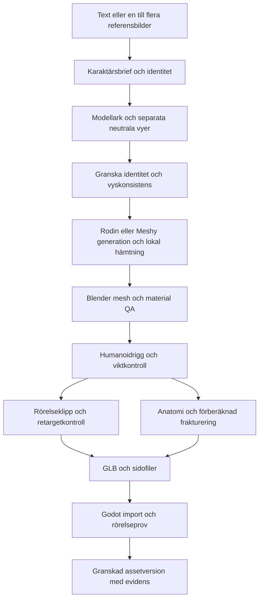

# Strandzombier: karaktärspipeline och skadestyrd animation

Uppdaterat: 2026-10-22. Status: sidoexperiment i Nordic Forest. **Den nya Rodin-modellen genererad i T-pose är vald geometrikälla.** [T-pose arbetsversion v1](../../output/zombie-beach/rodin-tpose-v1/README.md) har fått en första anpassad 52-bensrigg, nya benvikter, 11 Meshy-klipp och två överförda Rodin-klipp. Blender/GLB-återimport och Godot-import/animationskontroller har verifierats; en separat Godot-granskare finns. Tidigare [Rodin arbetsversion](../../output/zombie-beach/rodin-audit-v1/README.md) och [Meshy-reparation](../../output/zombie-beach/mesh-repair-v1/README.md) finns kvar som jämförelser och rörelsekällor. Fotkontakt, slutlig deformationsgranskning, jiggle-fysik, procedurrörelse, frakturering och installerad Langflow-karaktärspipeline återstår. Befintliga M0–M6 omprioriteras inte av detta dokument.

## Rekommendation

Fortsätt med **Rodin T-pose + Meshy-rörelser → Blender → Godot**. Animationerna är överförda till den nya riggen och kan granskas i Godot; fotkontakt och deformationskvalitet återstår att godkänna. Bevisa en komplett karaktär manuellt innan Langflow automatiserar stegen. AI producerar koncept, ett första mesh-/texturförslag och kodförslag; reproducerbara Blender-skript bygger skadegeometri och export, medan Godot beräknar rörelse och fysik lokalt.

Första versionen använder förberäknade Voronoi-fragment, ett litet antal rörelsemål och fysikreaktioner. En senare aktiv ragdoll försöker nå rörelsemålen genom begränsade krafter. Godtycklig meshskärning och en självlärande gångkontroller är egna forskningssteg.

Designvalen här är rekommendationer för experimentet. Länkad dokumentation visar verktygens delkapaciteter, inte att kombinationen redan fungerar i projektet.

## Karaktär och bildunderlag

Första identiteten: en tydligt vuxen blond kvinna, cirka 30 år, tidigare badgäst i Florida, med en ogenomskinlig sliten bikini, bara fötter, solränder och en matt, åldrad survival-horror-estetik inspirerad av de fem referensvyerna. Bevara ett eget ansikte och en egen kläd-/texturdesign.

En kollektion kan sedan dela skelettkonvention och skadeformat: badgäst, livräddare, pensionerad turist, surfare och strandfiskare. Kroppsform, hår och kläder behöver granskas per variant; gemensamt skelett gör inte automatiskt alla skin weights eller frakturer återanvändbara. Börja utan avancerad hår- och tygsimulering.

**Rekonstruktionsunderlag:** ett modellark med front, profil, rygg och trekvart; samma skala, neutral A-pose, rak rygg och huvud, fötter isär, händer fria från kroppen och mjukt jämnt ljus. Separera varje vy till en egen fil innan multi-image-inmatning. Frontvyn ligger först. Undvik att skicka ett helt fyrfigursark som en enda objektbild.

**Animationsreferens:** separat ark med idle, gångens kontakt-/passeringsposer, sträckning, snubbling och krypning. Dessa varierande poser ska inte blandas in i geometrirekonstruktionen. De beskriver rörelseintention men innehåller inga verkliga animationstracks. När meshen finns bör fler exakta karaktärsvyer renderas från samma 3D-källa; separata AI-bilder garanterar inte geometrisk överensstämmelse.

Den neutrala produktionsmodellen behåller alla lemmar och sammanhängande anatomi vid riggning. Hål och avskiljbara delar byggs efter att grundriggen fungerar.

Bildförsöken i denna session skapade **ingen bild**. Verktyget stoppade först en referensinspirerad zombievariant för våldsinnehåll och därefter en uttryckligen icke-grafisk variant för sexualitetsinnehåll. Båda exakta promptarna finns i [konceptmappen](../../output/zombie-beach/concepts/README.md). Bildgenereringsskillens CLI/API-fallback har inte körts.

## Från bild till riggad GLB

[Meshys multi-image-API](https://docs.meshy.ai/en/api/multi-image-to-3d) tar 1–4 vyer och har bland annat `pose_mode`, textur/PBR-val, remesh och GLB-utdata. Föreslagen pilot: separata neutrala vyer, `pose_mode: "a-pose"`, PBR och ett uttryckligt polygonmål. Mät faktiskt resultat; en polygoninställning garanterar inte bra ledtopologi. Spara leverantör/modellversion och parametrar vid varje körning.

[Rigging-API:t](https://docs.meshy.ai/en/api/rigging) gäller tydliga humanoider och kan lämna en riggad GLB och grundläggande gång-/löpklipp. API:t och webbgränssnittet kan ha olika stöd. För extern GLB-inmatning anger dokumentationen att ansiktet måste vara vänt mot +Z; testa axelkonverteringen till Godot separat. Kontrollera versionens krav innan implementation.

Blender är korrigerings- och produktionssteget: granska händer, armhålor, höfter, axlar och knän; reparera topologi där deformation kräver det; kontrollera UV, material och skin weights. Spara en redigerbar `.blend` och exportera den accepterade GLB:n. Retopologi efter riggning kräver viktöverföring och ny deformationskontroll.

Godot-provet verifierar enhetsskala, forward/up, root kontra bäcken, rest pose, material, loopning och fotkontakt. Välj in-place-gång eller root motion uttryckligen och använd samma konvention för alla klipp. Se även projektets [befintliga produktionskontrakt](../PRODUCTION-PIPELINES.md).

## Tre separata representationer av kroppen

| Representation | Innehåll | Användning |
| --- | --- | --- |
| Anatomiska regioner | Stabila region-ID:n för huvud, bröstkorg, bäcken, över-/underarmar, händer, lår, underben och fötter | Träffklassning, funktion och skadegränser |
| Frakturgeometri | Cell-ID, region-ID, grannskap, exponerbara snittytor och koppling till riggen | Synliga hål och lossnade fragment |
| Fysikkroppar | Förenklade kollisionsvolymer, massa, leder, gränser och motorstyrka | Ragdoll, impulser och rörelsekontroll |

En dold färg-/ID-mask är användbar för debug och shading. Spelreglerna bör använda stabila ID:n i metadata och träffvolymer; en interpolerad RGB-textur är inte ensam en robust anatomisk databas. Vertexgrupper eller face-attribut i Blender kan vara författningsunderlag. Exportören skriver uttrycklig mappning till Godot i stället för att anta att Blender-attribut överlever GLB-import.

Meshens benvikter anger deformation, inte hela skadeanatomin. En bröstkorg kan ha många celler men bara ett fåtal fysikkroppar. Att förlora en liten ytcell ska inte automatiskt avaktivera hela armen eller förstöra bröstkorgens bärighet.

## Voronoi och upprepade träffar

Använd [Blender Cell Fracture](https://extensions.blender.org/add-ons/cell-fracture/) som första verktygsreferens. Det är ett fraktureringsverktyg; riggning, skadeanatomi och Godot-styrning behöver byggas runt det. Verifiera extensionen i den installerade Blender-versionen.

Föreslagen implementation:

1. Skapa slutna volymer i rest pose per vald kroppsregion, med inre material och tydliga ledgränser. Börja med en underarm och en liten del av bröstkorgen.
2. Förberäkna celler med sparad seed och en graf över angränsande celler. Teststorlek: cirka 6–10 celler i underarmen och 12–24 i bröstregionen. Detta är startvärden att mäta, inte ett kapacitetslöfte.
3. Överför skin weights till yttre och nya inre vertices. Delade snittytor måste få kompatibla vikter så att cellerna följs åt under deformation. Undvik först snitt över axlar, höfter och armbågar.
4. Låt fastsittande delar följa skelettet utan en aktiv rigid body per cell. Dölj inre gränsytor tills en granne försvinner. Granska sömmar, normaler och draw calls; separata meshobjekt per cell kan bli dyra.
5. Vid träff: bestäm region och aktuell cell, ackumulera lokal skada och ta bort celler när tröskeln nås. En enkel första träffmodell använder kollisionsproxy per region; exakt cellval på böjda ytor behöver deformerade proxyer eller provtagning av aktuell skinning. En omvänd transform för ett enda ben räcker inte för en yta med blandade benvikter.
6. När en cell lossnar: fånga dess faktiskt deformerade geometri och transform i träffögonblicket, skapa förenklad konvex kollision och växla till rigid body. En restpose-fragmentmesh kopplad direkt till ett enda ben kan annars hoppa eller ändra form.
7. Överför rörelsetillstånd och träffimpuls. Inkludera bärarens linjära hastighet och vinkelhastighetens bidrag vid fragmentets position. Stäng av animation/skin-deformation för den lossnade biten och hantera kollision mot ursprungskroppen så att initial överlappning inte exploderar.
8. Exponera kvarvarande innerytor och uppdatera grafens förbindelser. Frånkopplade komponenter lossnar enligt skadeprofilen; en isolerad cell får inte sväva kvar.

Upprepade träffar kan därmed äta bort ett kluster av celler och bilda ett verkligt hål. Hud, inre volym och synliga snittytor måste finnas; en alpha-mask ensam ger ingen ny insida. Ett rent yttre skal räcker inte heller för ett övertygande genomgående hål. Tidig prototype kan använda slutna förenklade volymer och en separat inre stödstruktur.

Voronoi ger synliga upplösningsgränser och kan se stenlikt ut. Anpassa cellernas form/täthet till anatomin och kombinera senare med ytmarkeringar, mjukare skadekanter och valda separationszoner. Godtyckliga kontinuerliga snitt genom en animerad skinned mesh är en mycket större uppgift än detta förberedda system.

## Rörelse: intention, kontakter och krafter

Första fungerande nivån: ett fåtal klipp/rörelsemål, IK för markkontakt och partiell ragdoll för reaktioner. Den mer fysikstyrda nivån använder ett osynligt målskelett och en fysisk kropp som försöker följa det. En ren procedurgenerator kan senare ersätta klippen utan att skadeformatet behöver ändras.

En PD-regulator fungerar ungefär som en dämpad fjäder: rotationsfel ger korrigerande vridmoment, relativ vinkelhastighet ger dämpning och maximal kraft begränsar styrkan. Beräkna fel och mål i rätt ledrum. Teleportera inte dynamiska ben till måltransformen varje bildruta.

Ragdollsimulering skapar inte automatiskt en fungerande gång. Lägg till planering av fot-/handkontakter, höftens höjd och riktning, återhämtning samt val av möjliga rörelsemål. Kvarvarande massa, tyngdpunkt, ledstyrka och tillgängliga stödpunkter påverkar kontrollen. En statisk stödpolygon är en användbar approximation men inte en komplett dynamisk balanslösning.

| Tillstånd | Föreslaget rörelsemål |
| --- | --- |
| Båda benen användbara | Stapplande gång, varierad steglängd, IK och huvud-/bröstriktning |
| Ett ben kraftigt skadat | Lägre hastighet, ändrad höft och kontaktplan; snubbling/fall om kontrollen misslyckas |
| Upprätt gång saknar stöd | Fall följt av explicit kryp-/släpkontroller med kvarvarande armar/ben |
| En arm saknas | Inget mål eller motormoment för den delen; ändrad balans och möjliga krypkontakter |
| Bärande struktur eller rörelseförmåga utslagen | Minska aktiv kontroll och gå till full ragdoll |

Ett kosmetiskt hål i bröstet behöver inte betyda omedelbar kollaps. Definiera en separat strukturell/funktionell skadeprofil. När ett ben avskiljs tas dess kollision, stödfunktion och drivning bort från den kvarvarande kroppen. Skelettben kan finnas kvar för import-/animationsstabilitet men får inte ge osynliga krafter eller synlig geometri.

Godots [ragdollguide](https://docs.godotengine.org/en/stable/tutorials/physics/ragdoll_system.html) är startpunkten för fysikskelettet. [SkeletonModifier3D](https://docs.godotengine.org/en/stable/classes/class_skeletonmodifier3d.html) ger en plats för modifieringar efter animation; [PhysicalBoneSimulator3D](https://docs.godotengine.org/en/stable/classes/class_physicalbonesimulator3d.html) för över fysikresultat till skelettet. Den aktiva balans-/gångkontrollern återstår att implementera. Välj och dokumentera en Godot-version och fysikbackend för experimentet; blanda inte godtyckligt kod från äldre tutorials.

## Material att lära av och efterlikna i små prov

| Primärkälla | Avgränsat prov | Begränsning |
| --- | --- | --- |
| [Godots ragdolltutorial och demohänvisningar](https://docs.godotengine.org/en/stable/tutorials/physics/ragdoll_system.html) | Ett stabilt fall med ledgränser och kollision | Ingen färdig adaptiv gång |
| [PiCode: Active Ragdoll in Godot 4](https://www.youtube.com/watch?v=VRXHzTUe1-Y) | Återskapa hur en fysisk kropp följer ett mål i en separat scen | Äldre Godot 4-exempel; måste testas mot vald version |
| [Godot-Active-Ragdolls, källkod](https://github.com/R3X-G1L6AME5H/Godot-Active-Ragdolls) | Studera målskelett och leddrivning | README beskriver äldre `RigidBody`/`Generic6DOFJoint` och Bullet; inte en färdig Godot 4-installation |
| [Destronoi](https://github.com/seadaemon/Destronoi) | Voronoi på ett enkelt rigid-body-objekt | Beskriver Godot 4.2.x och beta; visar inte deformering/frakturering av riggade kroppar |
| [Cell Fracture](https://extensions.blender.org/add-ons/cell-fracture/) | Sluten volym, fragment och snittytor i Blender | Kräver egen viktöverföring och exportlogik |
| [Unity PuppetMaster](https://root-motion.com/puppetmasterdox/html/page5.html) | Studera separationen mellan animation, muskelstyrka och fysisk kropp | Unity-produkt; inget verifierat stöd här för godtyckligt lossnade lemmar |
| [Unreal Physical Animation](https://dev.epicgames.com/documentation/en-us/unreal-engine/physics-components-in-unreal-engine) | Studera fysikpåverkan ovanpå skeletal animation | Kräver separat skade-/balanslösning |
| [Unreal Chaos Destruction](https://dev.epicgames.com/documentation/en-us/unreal-engine/destruction-quick-start) | Studera fragment, kluster och förbindelser | Guiden utgår från statiska meshars Geometry Collections, inte en komplett zombiepipeline |
| [Chaos Flesh](https://dev.epicgames.com/documentation/unreal-engine/chaos-flesh-overview) | Studera lågupplöst inre simulering kopplad till synlig yta | Beskriver framför allt mjukdels-/muskeldeformation; är inte i sig avskiljning och adaptiv locomotion |

Godot är förstahandsvalet för detta önskade prov. Om snabbast möjliga avancerade aktiva ragdoll väger tyngre än motorvalet är Unity/PuppetMaster värt ett separat litet jämförelseprov. Verktygens faktiska kompatibilitet och tidsbesparing har inte mätts här.

[DeepMimic](https://xbpeng.github.io/projects/DeepMimic/) och [MaskedMimic](https://xbpeng.github.io/projects/MaskedMimic/) är relevanta forskningsreferenser för fysikbaserad rörelsekontroll. De gör inte en tränad policy automatiskt robust mot vilka amputationer som helst. Träning, olika skadefall, simulatoröverföring och inference i Godot blir ett separat utvecklingsspår. Börja med explicit kontakt-/tillståndskontroll.

## Föreslaget Langflow-flöde



En gren med en redan accepterad mesh kan hoppa över bild-/geometrigenerering. Bildinput med otillräckliga vyer ger en osäkerhet att granska, inte en garanti om korrekt baksida. Om Blender-korrigeringar kräver omriggning återupptas flödet därifrån med nya indatahashar.

Bygg en smal ny karaktärsoperation på projektets [befintliga jobbrygga](../LANGFLOW.md). Använd [Langflows Python-komponenter](https://docs.langflow.org/components/custom/) som gränssnitt; långvariga leverantörsjobb och Blender-processer hör hemma i jobbservern. Ett canvas räcker inte som beständig jobbkörning.

Varje steg behöver `asset_id`, revision, indatahashar, parametrar, leverantörens task-ID, status, lokala artefakter och valideringsrapport. Spara task-ID före fortsatt polling och återuppta befintligt jobb efter avbrott. Upprepa inte ett osäkert genereringsanrop blint. Separera `generated`, `validated` och `accepted`. Använd begränsade försök och explicit kreditbudget för genereringsstegen; lagra nycklar i servermiljön. Hämta resultat lokalt medan leverantörslänkarna är giltiga. Standardläge för den nya komponenten är preview; avsiktlig livekörning producerar externa jobb.

Föreslagen exportbundle:

```text
character.blend             redigerbar källa
character.glb               mesh, material, skin, skeleton och valda klipp
anatomy.json                regioner, funktion och benmappning
fractures.json              celler, grannar, gränsytor och riggkoppling
physics-profile.json       massor, ledgränser, drivning och kollisionsregler
asset-manifest.json        källor, parametrar, versioner, hashar och status
validation.json            import-, deformations- och rörelsebevis
```

Fysikprofilen, skadegrafen och Godot-kontrollern behöver en Godot-adapter/scen. GLB ensam gör inte en karaktär till en spelklar aktiv ragdoll. Ändrad topologi ogiltigförklarar berörda vikter, celler, ID-mappningar och tidigare validering.

## Små arbetspaket i ordning

| Paket | Leverans | Acceptans som måste observeras |
| --- | --- | --- |
| Z0 | Enkel testhumanoid och Godot-ragdoll | Import, ledgränser, stabilt fall och reset; dokumenterad motor/backend |
| Z1 | En accepterad strandkaraktär | Granskad identitet, Blender-källa, riggad GLB, idle/gång, skala, deformation och fotkontakt i Godot |
| Z2 | En avskiljbar underarm | Lossnar i aktuell böjd pose utan hopp, dubblerad geometri eller osynlig kollision; får rimlig rörelse och reset fungerar |
| Z3 | Liten frakturerad bröstregion | Samma ställe kan träffas upprepat och ge växande hål med synlig insida; grannskap och frånkopplade delar uppdateras |
| Z4 | Skadestyrd rörelse | Gång, fall och krypning i minst två definierade ben-/armskador; borttagna delar används inte som stöd eller motorer |
| Z5 | Automatiserad produktion | En andra karaktär körs genom Langflow med spårbara filer; avbrott/återupptagning ger inte dubbla leverantörsjobb |

Z0 kan göras med en enkel egen testfigur medan konstunderlaget tas fram. Z2–Z4 bör först bevisas på den enkla figuren om den genererade meshen behöver längre korrigering.

Fokuserad kontroll: visa färgade regioner och ID:n i debug; verifiera hand/elbow/knee i extrema men tillåtna poser; återspela samma träfflista och jämför skade-ID:n. Fysikförlopp över maskiner behöver inte vara bitidentiska. Kontrollera både reset och sparad skadestatus om prototypen inför save/load. Mät 1, 5 och 20 figurer som stressteg, med render-/fysiktid, p95/p99, draw calls, minne och antal aktiva kroppar. Detta är mätpunkter, inte utlovade samtidiga fiender. Poola fragment, sätt livslängd och sov/frikoppla vilande rester enligt budget. Håll fysikens detaljnivå separat från den visuella och återanvänd inte en tidigare Macs resultat som bevis för en annan.

Första spelbara demomålet: en zombie närmar sig, en arm kan lossna, en definierad benskada ger fall och krypning, upprepade bröstträffar tar bort förberedda celler och en strukturell tröskel ger kollaps. Först därefter utökas kollektionen och de mer fria procedurrörelserna.
